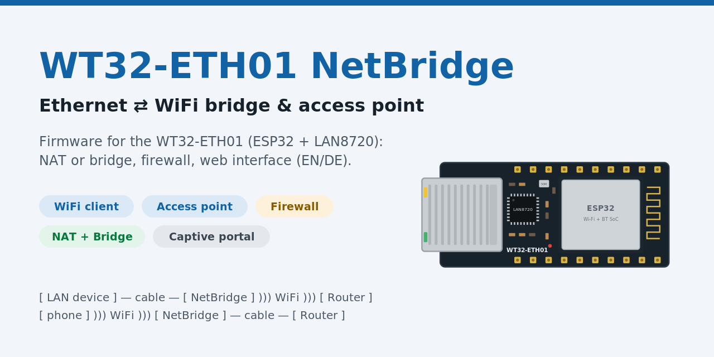
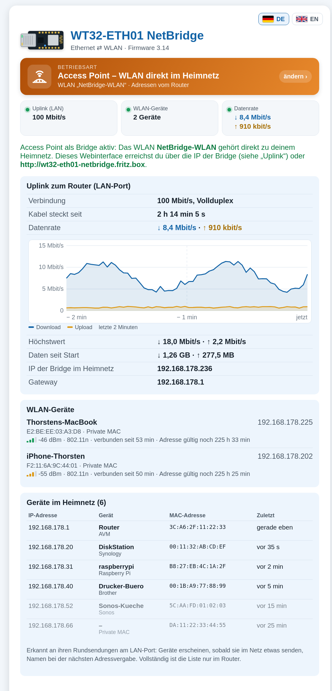
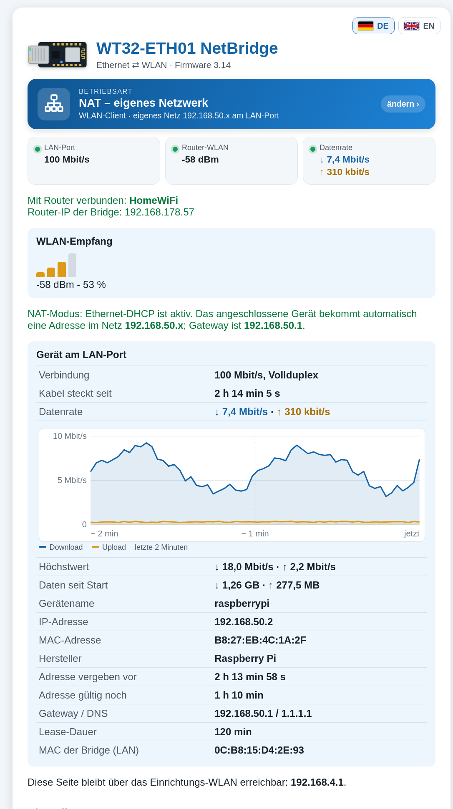
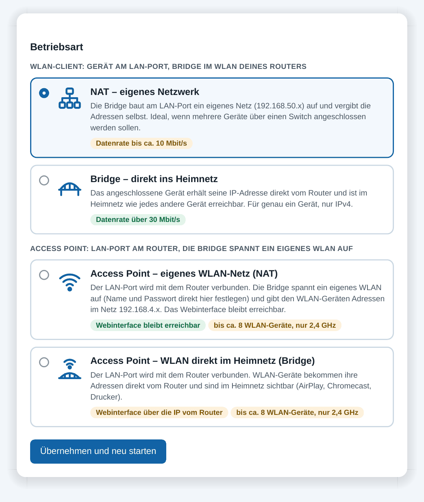
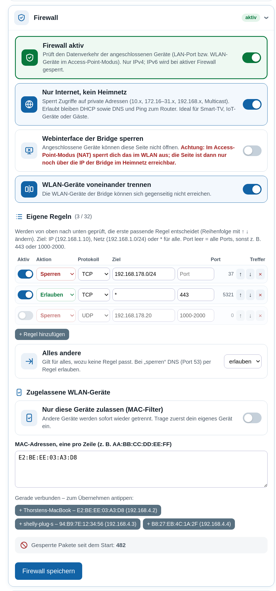
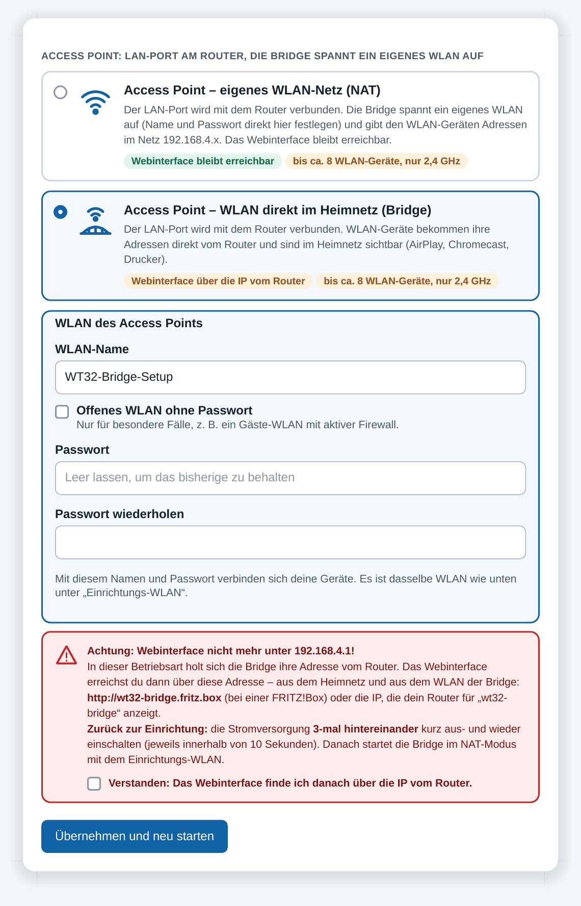
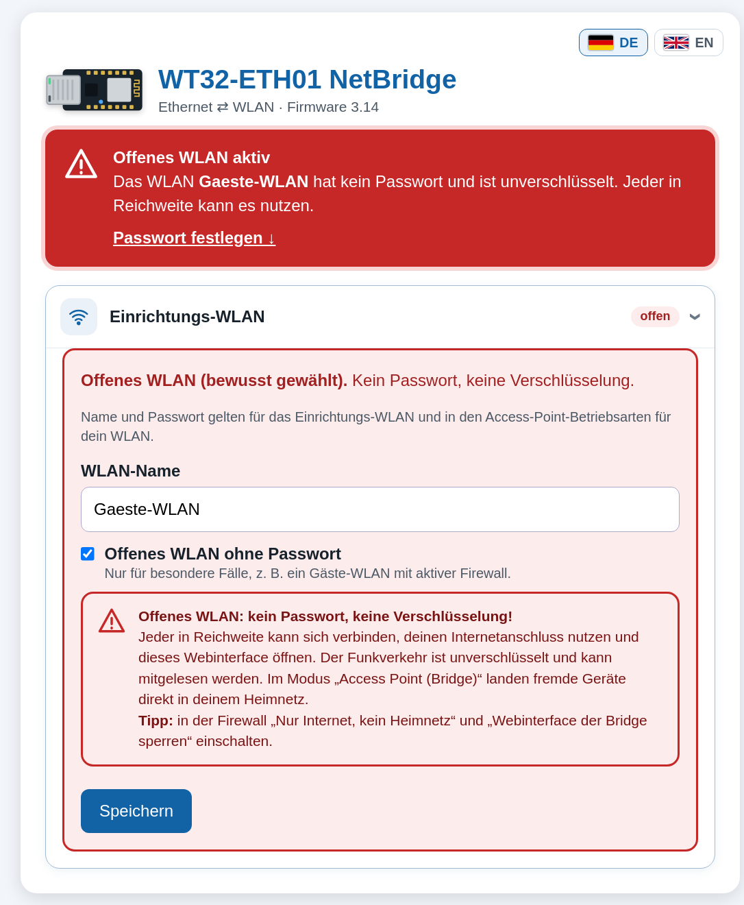
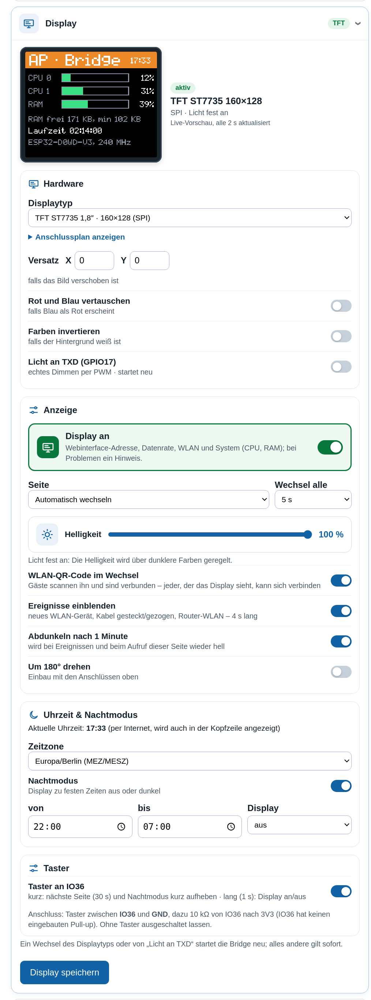
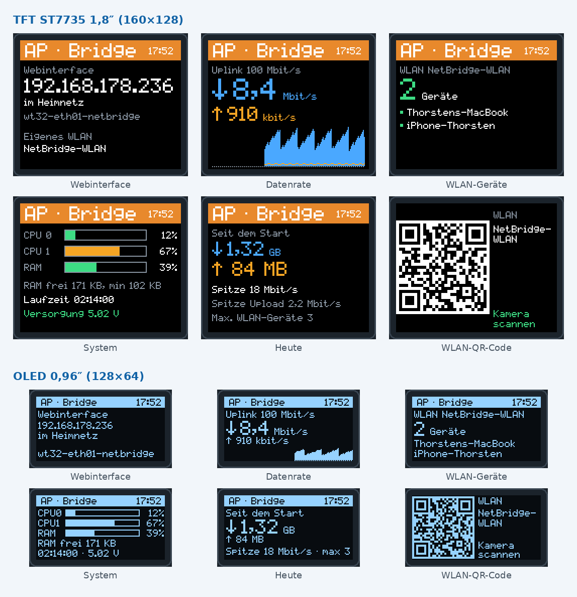

# WT32-ETH01 NetBridge – Ethernet ⇄ WLAN Bridge & Access Point (ESP32 + LAN8720)

🇬🇧 [English](README.md) | 🇩🇪 **Deutsch**

[](CHANGELOG.de.md)
[](#hardware)
[](#bauen-und-flashen)
[](LICENSE)
[](https://buymeacoffee.com/sykh)

**Version 3.14** – siehe [Änderungsprotokoll](CHANGELOG.de.md)

**WT32-ETH01 NetBridge** ist eine Firmware für das **WT32-ETH01 v1.4** (ESP32 + LAN8720), die Ethernet und
WLAN in beide Richtungen verbindet:

- **WLAN-Client:** bringt ein Gerät mit LAN-Anschluss ins WLAN – ein **WLAN-Adapter für Geräte ohne
  WLAN**, z. B. Drucker, Smart-TV, Spielkonsole, NAS, SPS oder Messgeräte.
- **Access Point:** per Kabel am Router, spannt die NetBridge ein **eigenes WLAN** auf – als kleiner
  Access Point, Gäste-WLAN oder WLAN-Erweiterung, auf Wunsch mit Firewall.
- **Optionales Display:** OLED oder Farb-TFT mit Adresse, Datenrate, Geräten, CPU/RAM, WLAN-QR-Code
  für Gäste und Uhrzeit.

<p align="center">
  
</p>

```
WLAN-Client:   [ Gerät mit LAN ] ──Kabel── [ WT32-ETH01 NetBridge ] ))) WLAN ))) [ Router ] ── Internet
Access Point:  [ Handy, Laptop ] ))) WLAN ))) [ WT32-ETH01 NetBridge ] ──Kabel── [ Router ] ── Internet
```

## Webinterface

<p align="center">
  
</p>

Das Webinterface (Version 3.14, Access Point als Bridge): Abbildung des Boards mit Live-Status-LEDs,
die aktuelle Betriebsart, Statuskacheln, Datenrate mit Verlauf der letzten 2 Minuten, die verbundenen
WLAN-Geräte mit Name, Hersteller, Signal und Lease sowie die Geräte im Heimnetz. Die Einstellungen
darunter sind aufklappbare Abschnitte. Das Webinterface gibt es auf Deutsch und Englisch, umschaltbar
über die Flaggen oben rechts.

## Screenshots

Alle Screenshots mit Beschreibung: **[Screenshot-Album](docs/SCREENSHOTS.de.md)**.

<table>
<tr><td align='center' width='33%'><a href='docs/SCREENSHOTS.de.md'></a><br><sub>Status im NAT-Modus</sub></td><td align='center' width='33%'><a href='docs/SCREENSHOTS.de.md'></a><br><sub>Betriebsarten</sub></td><td align='center' width='33%'><a href='docs/SCREENSHOTS.de.md'></a><br><sub>Firewall</sub></td></tr>
<tr><td align='center' width='33%'><a href='docs/SCREENSHOTS.de.md'></a><br><sub>Access Point einrichten</sub></td><td align='center' width='33%'><a href='docs/SCREENSHOTS.de.md'></a><br><sub>Status im Access-Point-Modus</sub></td><td align='center' width='33%'><a href='docs/SCREENSHOTS.de.md'></a><br><sub>Bewusst offenes WLAN</sub></td></tr>
<tr><td align='center' width='33%'><a href='docs/SCREENSHOTS.de.md'></a><br><sub>Display-Einstellungen mit Live-Vorschau</sub></td><td align='center' colspan='2'><a href='docs/SCREENSHOTS.de.md'></a><br><sub>Display-Seiten (TFT und OLED)</sub></td></tr>
</table>

## Funktionen

**Betriebsarten** (umschaltbar im Webinterface)

- **NAT – eigenes Netzwerk** (Standard): eigenes Netz `192.168.50.0/24` am LAN-Port mit DHCP-Server,
  Internetfreigabe über NAPT. Mehrere Geräte möglich (z. B. über einen Switch). Bis ca. 10 Mbit/s.
- **Bridge – direkt ins Heimnetz** (experimentell): Das LAN-Gerät bekommt seine IP-Adresse **direkt vom
  Router**. Nur ein Gerät, nur IPv4. Über 30 Mbit/s.
- **Access Point – eigenes WLAN-Netz (NAT)**: LAN-Port am Router, die Bridge spannt ein eigenes WLAN
  (`192.168.4.x`) für bis zu ca. 8 Geräte auf. Das Webinterface bleibt erreichbar.
- **Access Point – WLAN direkt im Heimnetz (Bridge)**: WLAN-Geräte bekommen ihre IP direkt vom Router;
  das Webinterface ist über die IP der Bridge erreichbar (z. B. `http://wt32-eth01-netbridge.fritz.box`).

**Webinterface** (Deutsch und Englisch, umschaltbar per Flaggen-Button)

- Kopfbereich mit Board-Abbildung und Live-Status-LEDs, farbigem **Banner der Betriebsart** und
  Statuskacheln (LAN, WLAN, Datenrate); Einstellungen als aufklappbare Abschnitte mit Status-Badges
- **Live-Datenrate** am LAN-Port mit Verlauf der letzten 2 Minuten, Höchstwerten und Datenmenge
- **Geräteübersicht**: WLAN-Geräte und LAN-Gerät mit Name (aus DHCP), Hersteller (bzw. „Private MAC“),
  IP, Signal, WLAN-Standard, Verbindungsdauer und Restlaufzeit der DHCP-Vergabe
- **Geräte im Heimnetz** (Access Point als Bridge): IP, Name, Hersteller, MAC und „zuletzt gesehen“,
  passiv erkannt an ihren Rundsendungen
- WLAN-Suche, Router-Zugangsdaten, Passwort des Einrichtungs-WLANs, Captive Portal im Einrichtungs-WLAN

**Sicherheit**

- **Firewall** für die angeschlossenen Geräte: „Nur Internet, kein Heimnetz“, Webinterface sperren,
  WLAN-Geräte trennen, bis zu **32 eigene Regeln** (hinzufügen, verschieben, löschen) mit Trefferzähler,
  MAC-Liste
- **Passwortschutz für das Webinterface** (optional, gesalzener Hash, Sitzungs-Cookie, Sperre nach
  Fehlversuchen)
- **Notfall-Reset**: 3-mal hintereinander Strom aus/an setzt auf NAT zurück und entfernt das
  Webinterface-Passwort

**Optionales Display** (OLED SSD1306/SSD1315 per I²C oder Farb-TFT ST7735 per SPI)

- Seiten: Adresse des Webinterface, Datenrate mit Verlauf, WLAN, **System** (CPU, RAM), **Heute**
  (Datenmenge, Spitzenwerte) und ein **WLAN-QR-Code** für Gäste; im Wechsel oder eine feste Seite
- **Ereignis-Hinweise** (neues Gerät, Kabel, Router-WLAN), **Uhrzeit** per NTP, **Nachtmodus**,
  Helligkeitsregler, Einbrennschutz, optionaler **Taster** an IO36
- **Live-Vorschau** des Displays im Webinterface

**Diagnose**

- **Serielle Konsole** mit Befehlen: Systemstatus mit **CPU-Last je Kern**, RAM, Firmware-Größe, Grund
  des letzten Starts (inkl. Brownout), optionale **Messung der 5-V-Versorgung**, Task-Liste
- Einstellungen dauerhaft im Flash (NVS); keine externen Bibliotheken nötig

## Hardware

- WT32-ETH01 v1.4 von Wireless-Tag: ESP32-Modul, LAN8720-Ethernet-PHY, RJ45-Buchse (10/100 Mbit/s),
  Versorgung mit 5 V **oder** 3,3 V
- USB-TTL-Adapter mit **3,3 V**-Logik zum Flashen (z. B. CP2102 oder CH340)

| Adapter | WT32-ETH01 |
|---------|------------|
| TX      | RX0 (GPIO3) |
| RX      | TX0 (GPIO1) |
| GND     | GND |
| 5V      | 5V (oder 3,3 V an 3V3, nur eines von beiden) |

Zum Flashen **IO0 mit GND verbinden** und dann das Board einschalten. Nach dem Flashen die Brücke
entfernen und neu starten.

### Pinbelegung der Stiftleisten

Laut [Wireless-Tag-Wiki](https://wiki.wireless-tag.com/docs/en/WT32-ETH01/board_features.html):

| Leiste 1 | Funktion | Leiste 2 | Funktion |
|----------|----------|----------|----------|
| EN | Enable (aktiv high) | GND | Masse |
| CFG | IO32 (Werksreset) | IO39 | nur Eingang |
| 485_EN | IO33 (RS485-Enable) | IO36 | nur Eingang |
| RXD | IO5 (UART2 RX) | IO15 | GPIO |
| TXD | IO17 (UART2 TX) | IO14 | GPIO |
| GND | Masse | IO12 | GPIO |
| 3V3 | 3,3 V Ein-/Ausgang | IO35 | nur Eingang |
| GND | Masse | IO4 | GPIO |
| 5V | 5 V Ein-/Ausgang | IO2 | GPIO |
| LINK | Link-LED | GND | Masse |

Zum Flashen dienen die Programmier-Pins **TXD0 (IO1), RXD0 (IO3), GND, 3V3, EN und IO0**.

Verwendete Pins intern: GPIO16 (Oszillator-Enable LAN8720), GPIO23 (MDC), GPIO18 (MDIO),
GPIO0 (50-MHz-RMII-Takt-Eingang), PHY-Adresse 1.

### Optional: Display

Der Displaytyp wird im Webinterface unter „Display“ gewählt (nach einer Änderung startet die Bridge neu).

**OLED 128×64, SSD1306 oder SSD1315** (4-poliges I²C-Modul, Standard). Es wird beim Start automatisch
erkannt; ohne Display ändert sich nichts.

| Display | WT32-ETH01 |
|---------|------------|
| GND | GND |
| VCC | 3V3 |
| SCL | CFG (GPIO32) |
| SDA | 485_EN (GPIO33) |

Das Display wechselt (alle 3–30 Sekunden, einstellbar) zwischen der Adresse des Webinterface, der Datenrate am LAN-Port
(mit Verlauf der letzten Minute) dem WLAN-Status (Signal bzw. verbundene Geräte) und dem
System (CPU-Last je Kern, RAM, Laufzeit, Versorgungsspannung falls gemessen); stimmt etwas
nicht (kein Kabel, Router-WLAN getrennt, keine IP), kommt eine Hinweisseite dazu. Alternativ lässt sich eine
Seite fest anzeigen (Einstellung „Seite“); ein Hinweis erscheint dann trotzdem im Wechsel. Ereignisse
(neues WLAN-Gerät, Kabel gesteckt/gezogen, Router-WLAN) werden 4 Sekunden eingeblendet, und das
Webinterface zeigt eine **Live-Vorschau** des Displays.

Weitere Display-Funktionen (Webinterface → Display):

- **WLAN-QR-Code**: Gäste scannen ihn mit der Handykamera und sind verbunden (optionale Seite; jeder, der
  das Display sieht, kann sich verbinden).
- **Heute**: Datenmenge Download/Upload, Spitzenwerte und max. WLAN-Geräte seit Mitternacht (bzw. seit
  dem Start).
- **Uhrzeit** in der Kopfzeile (per Internet/NTP, Zeitzone wählbar).
- **Nachtmodus** (abschaltbar): Display zwischen zwei Uhrzeiten aus oder dunkel, z. B. 22:00–07:00.
- **Taster** (optional): zwischen **IO36** und **GND**, dazu 10 kΩ von IO36 nach 3V3. Kurz drücken:
  nächste Seite für 30 s und Nachtmodus kurz aufheben; lang (1 s): Display an/aus. Einbrennschutz:
Der Inhalt verschiebt sich jede Minute um wenige Pixel, und nach 1 Minute wird das Display abgedunkelt
(bei Ereignissen und beim Öffnen des Webinterface wird es wieder hell). An/aus, Abdunkeln und Drehen um
180° lassen sich im Webinterface unter „Display“ einstellen. GPIO2, 12 und 15 nicht fürs Display
verwenden – das sind Boot-Pins.

**Farb-TFT mit ST7735** – 1,8″ 160×128, 1,44″ 128×128 oder 0,96″ 160×80. Das ST7735 hat **kein I²C**:
Die mit SCL/SDA beschrifteten Anschlüsse dieser Module sind SPI-Takt und -Daten.

| TFT-Modul | WT32-ETH01 |
|-----------|------------|
| GND / VCC | GND / 3V3 |
| BL (LED) | frei lassen (Licht an), oder TXD (GPIO17) für echtes Dimmen |
| SCL (SCK) | CFG (GPIO32) |
| SDA (MOSI) | 485_EN (GPIO33) |
| DC (A0) | IO4 |
| CS | IO14 |
| RES (RST) | RXD (GPIO5) |

Das TFT zeigt dieselben Seiten in Farbe (Kopfzeile in der Farbe der Betriebsart, Download blau, Upload
orange, Warnungen rot); 160×128 und 128×128 nutzen ein größeres Layout. Ist das Bild verschoben oder
stimmen die Farben nicht, helfen Versatz X/Y, „Rot und Blau vertauschen“ bzw. „Farben invertieren“ im
Webinterface (Voreinstellungen je Modulgröße werden automatisch eingetragen). Ist BL frei (die meisten Module schalten das
Licht dann selbst ein), regelt der Helligkeitsregler über dunklere Farben; mit BL an TXD (GPIO17) und eingeschaltetem
„Hintergrundlicht an TXD“ regelt er die Beleuchtung selbst (PWM).

## Bauen und Flashen

Eine ausführliche Schritt-für-Schritt-Anleitung (auch ohne Kommandozeile) steht im
**[Tutorial](docs/TUTORIAL.de.md)**.

Kurzfassung mit [PlatformIO](https://platformio.org/) (`brew install platformio`):

```bash
pio run -t upload        # bauen und flashen
pio device monitor       # serielle Ausgabe (115200 Baud)
```

Die Firmware braucht **Arduino-Core 3.x (ESP-IDF 5)**. Die `platformio.ini` nutzt dafür die
[pioarduino](https://github.com/pioarduino/platform-espressif32)-Plattform. Mit dem Standard-Paket
`platform = espressif32` (Arduino-Core 2.x) lässt sich der Ethernet-Teil nicht kompilieren.

## Einrichtung

1. Mit dem WLAN **`WT32-ETH01-NetBridge-Setup`** verbinden. Beim ersten Start ist es **offen (ohne Passwort)**.
2. Die Einrichtungsseite öffnet sich automatisch (Captive Portal, wie bei Hotel-WLANs). Falls nicht,
   `http://192.168.4.1` öffnen.
3. Router-WLAN auswählen, Passwort eingeben, speichern.
4. Ein Passwort für das Einrichtungs-WLAN festlegen (bis dahin zeigt das Webinterface eine rote Warnung).
5. Gerät per Kabel am LAN-Port anschließen.

## WLAN-Passwörter

Die Bridge kennt zwei Passwörter:

| Passwort | Wo steht es? | Wie ändern? |
|----------|--------------|-------------|
| **Einrichtungs-WLAN** `WT32-ETH01-NetBridge-Setup` (anfangs **offen**, ohne Passwort) | im Flash des ESP32 (NVS); ein optionaler Standardwert lässt sich in `SETUP_AP_PASSWORD` in `src/main.cpp` setzen | im Webinterface unter „Einrichtungs-WLAN“ (8–63 Zeichen), die Bridge startet danach neu |
| **Router-WLAN** | im Flash des ESP32 (NVS), nicht im Code | im Webinterface unter „Router-WLAN“ neu eingeben und „Speichern und verbinden“ |

> **Bewusst offenes WLAN:** In den WLAN-Einstellungen (und bei den Access-Point-Betriebsarten) lässt
> sich „Offenes WLAN ohne Passwort“ anhaken, z. B. für ein Gäste-WLAN. Eine rote Warnung erklärt die
> Risiken und bleibt oben im Webinterface sichtbar; am besten mit der Firewall kombinieren („Nur
> Internet“, „Webinterface sperren“).

> **Wichtig:** Beim ersten Start ist das Einrichtungs-WLAN offen, jeder in Reichweite könnte die
> Einstellungen ändern. Das Webinterface zeigt eine auffällige rote Warnung, bis ein Passwort gesetzt
> ist. Lege es direkt nach der Einrichtung fest. Details: [Tutorial, Abschnitt WLAN-Passwörter](docs/TUTORIAL.de.md#7-wlan-passwörter-finden-und-ändern).

## Betriebsarten im Detail

### NAT – eigenes Netzwerk

Die Bridge baut am LAN-Port ein eigenes Netz auf und vergibt die Adressen selbst. Ideal, wenn
mehrere Geräte über einen Switch angeschlossen werden sollen. Datenraten bis ca. 10 Mbit/s.

- Bridge-Adresse im LAN: `192.168.50.1` (Gateway)
- DHCP-Bereich: `192.168.50.x`, DNS: `1.1.1.1`
- Internetverkehr wird per NAPT über das WLAN geleitet.

### Bridge – direkt ins Heimnetz (experimentell)

Das angeschlossene Gerät erhält seine IP-Adresse direkt vom Router und ist im Heimnetz wie jedes
andere Gerät erreichbar. Datenraten über 30 Mbit/s.

Ein WLAN-Client darf nur Pakete mit seiner eigenen MAC-Adresse senden. Die Bridge schreibt deshalb
die MAC-Adressen in den Paketen um, auch in DHCP- und ARP-Paketen. Das gleiche Verfahren nutzt
Espressifs Beispiel
[`sta2eth`](https://github.com/espressif/esp-idf/tree/master/examples/network/sta2eth).

Einschränkungen:

- nur **ein** Gerät am LAN-Port, nur **IPv4**
- im Router erscheint das Gerät mit der **WLAN-MAC der Bridge** (wird im Webinterface angezeigt).
  Feste IP-Zuweisungen im Router müssen auf diese MAC eingetragen werden.
- die Bridge hat im Router-Netz keine eigene IP; das Webinterface ist nur über das
  Einrichtungs-WLAN erreichbar
- nutzt interne ESP-IDF-WLAN-Funktionen (`esp_wifi_internal_*`), die sich mit Core-Updates
  ändern können
- nach dem Umschalten der Betriebsart am LAN-Gerät kurz das Kabel ziehen, damit es eine neue
  Adresse holt

### Access Point – eigenes WLAN-Netz (NAT)

Den LAN-Port mit dem Router verbinden. Die Bridge holt sich per DHCP eine Adresse vom Router und
spannt ein eigenes WLAN auf (Name und Passwort aus dem Abschnitt „Einrichtungs-WLAN“). Die
WLAN-Geräte bekommen Adressen im Netz `192.168.4.x`; als DNS dient der DNS-Server des Routers. Das
Webinterface bleibt unter `192.168.4.1` und über die IP der Bridge im Heimnetz erreichbar.

- bis ca. 8 WLAN-Geräte, nur 2,4 GHz, die Datenrate teilen sich alle Geräte
- vor dem Umschalten muss ein WLAN-Passwort festgelegt sein

### Access Point – WLAN direkt im Heimnetz (Bridge)

Den LAN-Port mit dem Router verbinden. Die Frames werden auf Ebene 2 zwischen Ethernet und dem
WLAN-Access-Point weitergereicht (wie in Espressifs Beispiel
[`eth2ap`](https://github.com/espressif/esp-idf/tree/master/examples/network/eth2ap)). Die
WLAN-Geräte bekommen ihre Adressen direkt vom Router und sind im Heimnetz sichtbar (AirPlay,
Chromecast, Drucker).

> **Hinweis:** In dieser Betriebsart ist das Webinterface **nicht mehr unter 192.168.4.1** erreichbar.
> Die Bridge holt sich per DHCP eine eigene Adresse vom Router (Gerätename `wt32-eth01-netbridge`); unter dieser
> Adresse ist das Webinterface erreichbar – aus dem Heimnetz und aus dem WLAN der Bridge, z. B.
> `http://wt32-eth01-netbridge.fritz.box` oder die IP aus der Geräteliste des Routers. Vor dem Umschalten fragt
> das Webinterface nach einer Bestätigung.
>
> **Zurück zur Einrichtung (Notfall-Reset):** die Stromversorgung **3-mal hintereinander** kurz aus-
> und wieder einschalten, jeweils innerhalb von 10 Sekunden. Danach startet die Bridge im NAT-Modus mit
> dem Einrichtungs-WLAN, und das Passwort des Webinterface ist entfernt; alle anderen Einstellungen
> bleiben erhalten.

## Firewall

Abschnitt „Firewall“ im Webinterface. Sie prüft den Datenverkehr der **angeschlossenen Geräte**
(Gerät am LAN-Port bzw. die WLAN-Geräte in den Access-Point-Betriebsarten). Änderungen gelten sofort,
ein Neustart ist nicht nötig.

| Einstellung | Wirkung |
|-------------|---------|
| Nur Internet, kein Heimnetz | sperrt private Adressen (10.x, 172.16–31.x, 192.168.x, Multicast); DHCP, DNS und Ping zum Router bleiben erlaubt. In den Bridge-Betriebsarten werden zusätzlich Verbindungen aus dem Heimnetz zum Gerät gesperrt. |
| Webinterface der Bridge sperren | angeschlossene Geräte können die Einstellungsseite nicht öffnen |
| WLAN-Geräte trennen (AP-Betriebsarten) | die WLAN-Geräte der Bridge erreichen sich gegenseitig nicht |
| Eigene Regeln (bis zu 32) | sperren/erlauben, Protokoll (alle/TCP/UDP/ICMP), Ziel-IP oder -Netz, Port oder Portbereich; die erste passende Regel entscheidet; Trefferzähler je Regel |
| Alles andere | erlauben (Standard) oder sperren |
| MAC-Filter (AP-Betriebsarten) | nur eingetragene WLAN-Geräte dürfen sich verbinden; schützt vor dem Selbstaussperren |

Grenzen: zustandslos (keine Verbindungsverfolgung; in den NAT-Betriebsarten blockiert NAT ohnehin
unaufgeforderte Verbindungen von außen), nur IPv4 (IPv6 wird bei aktiver Firewall gesperrt), nur
IP-Adressen, keine Domainnamen.

## Projektstruktur

```
platformio.ini            Build-Konfiguration
src/main.cpp              Firmware
src/oui_table.h           Herstellertabelle (MAC-Präfixe), erzeugt von tools/gen_oui.py
src/display.h             Treiber für die optionalen OLED- und TFT-Displays
src/qr.h                  kleiner QR-Code-Generator (WLAN-QR-Code auf dem Display)
src/oled_font.h           Schrift fürs Display, erzeugt von tools/gen_font.py
docs/TUTORIAL.de.md       Tutorial: Kompilieren und Flashen (Deutsch)
docs/TUTORIAL.en.md       Tutorial: build and flash (English)
docs/webinterface-v2.4.png Screenshot des Webinterface (echtes Gerät)
docs/SCREENSHOTS.de.md    Screenshot-Album (DE), docs/screenshots/en|de/
docs/wt32-eth01-netbridge-banner.png Banner auf der Startseite
tools/make_preview.py     erzeugt Banner und Vorschaubild neu
docs/wt32-eth01.svg       Illustration des Boards
docs/social-preview.png   Vorschaubild für GitHub
CHANGELOG.de.md           Änderungsprotokoll (Deutsch)
CHANGELOG.md              changelog (English)
LICENSE                   MIT-Lizenz
tools/release.sh          baut die Firmware und legt einen GitHub-Release an
tools/gen_oui.py          erzeugt src/oui_table.h neu aus der IEEE-OUI-Liste
tools/gen_font.py         erzeugt src/oled_font.h neu (Schrift fürs Display)
backup/main_nat_only.cpp  ältere Version nur mit NAT-Modus
```

## Versionen

Aktuelle Version: **3.14** – Display: WLAN-QR-Code, Tagesstatistik, Uhrzeit, Nachtmodus, Taster.
Fertige Firmware-Dateien hängen an jedem [Release](../../releases).
Alle Änderungen stehen im **[Änderungsprotokoll](CHANGELOG.de.md)**.

## Unterstützen

Wenn dir das Projekt hilft, freue ich mich über einen Kaffee:

<a href="https://buymeacoffee.com/sykh"></a>

## Serielle Konsole und Systemstatus

Im seriellen Monitor (`pio device monitor`, 115200 Baud) gibt die Bridge alle 10 Sekunden eine
Statuszeile aus (Betriebsart, WLAN, **CPU-Last je Kern**, freier RAM) und 15 Sekunden nach dem Start
einmal den kompletten Systemstatus. Befehle (eintippen und Enter drücken). Die Firmware bestätigt jeden erkannten Befehl mit
einer Zeile `> befehl`; erscheint sie nicht, kommt die Eingabe nicht beim ESP32 an (Leitung Adapter
TX → RX0/IO3 prüfen). In der Arduino-IDE das Eingabefeld oben verwenden:

| Befehl | Funktion |
|--------|----------|
| `status` oder `s` | Systemstatus: Laufzeit, Grund des letzten Starts (inkl. Brownout), Chip, Flash, Firmware-Größe, CPU-Last je Kern mit den aktivsten Tasks, RAM, Einstellungsspeicher, Versorgungsspannung, LAN/WLAN, Adresse des Webinterface, Display |
| `tasks` oder `t` | alle Tasks mit Kern, CPU-Anteil und freiem Stack |
| `vmon on` / `vmon off` | 5-V-Versorgung messen (braucht einen Spannungsteiler, siehe unten) |
| `vmon cal 5.02` | mit der per Multimeter gemessenen Spannung kalibrieren |
| `diag off` / `diag on` / `diag 60` | Statuszeile aus, an (alle 10 s) oder alle 60 s |
| `reboot` | Neustart |

**Versorgungsspannung:** Der ESP32 kann seine eigene Versorgungsspannung nicht messen. Für eine Messung
einen Spannungsteiler aus zwei gleichen Widerständen (z. B. 2 × 10 kΩ) von **5V nach GND** schalten und
die Mitte an **IO39** anschließen (nur Eingang, frei). Danach einmal `vmon on` eingeben. Unter 4,6 V
zeigt der Status eine Warnung. Am Grund des letzten Starts erkennst du, ob die Bridge wegen Unterspannung
(Brownout) neu gestartet ist.

```
═══ WT32-ETH01 NetBridge 3.9 · Systemstatus ═══
 CPU
   Kern 0 ........... [██░░░░░░░░░░░░░░░░░░]  10 %
   Kern 1 ........... [█░░░░░░░░░░░░░░░░░░░]   4 %
   Top-Tasks ........ wifi 3.0 %, eth2ap 2.2 %, loopTask 1.2 %, tiT 0.8 %
 Versorgung
   5V-Eingang ....... 5.02 V   ok
   Brownout ......... nein
```

## Fehlersuche

Die serielle Ausgabe (115200 Baud) zeigt den Zustand an, z. B.:

```
Betriebsart: NAT
DHCP server started on interface ETH_LAN with IP: 192.168.50.1
Ethernet-LAN: 192.168.50.1, DHCP-Server laeuft
Ethernet-Kabel verbunden (100 Mbit/s, Vollduplex)
LAN-Geraet AA:BB:CC:DD:EE:FF hat 192.168.50.2 bekommen
```

Weitere Hinweise stehen im [Tutorial](docs/TUTORIAL.de.md#8-probleme-lösen).

## Lizenz

Veröffentlicht unter der [MIT-Lizenz](LICENSE): Der Code darf frei verwendet, verändert und
weitergegeben werden, auch kommerziell. Der Copyright-Hinweis muss dabei erhalten bleiben.
